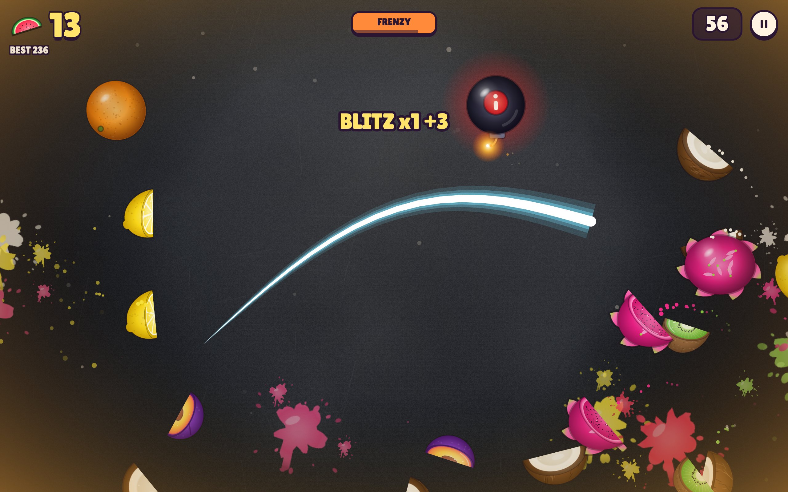
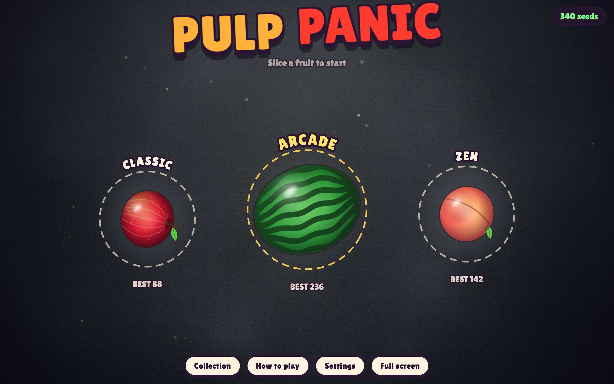
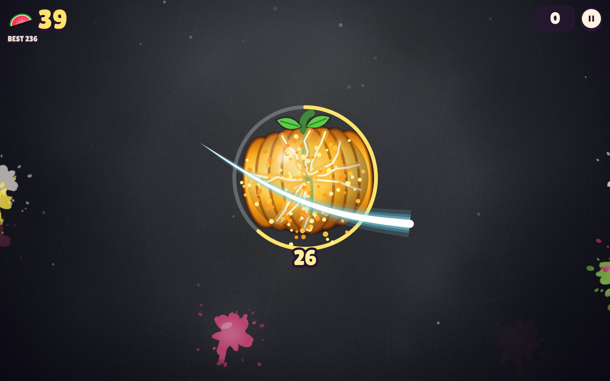
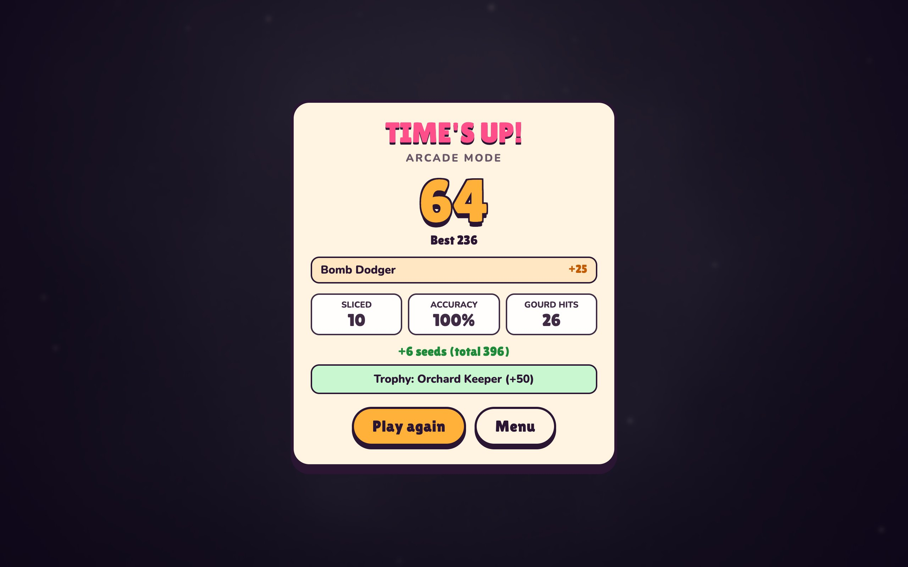
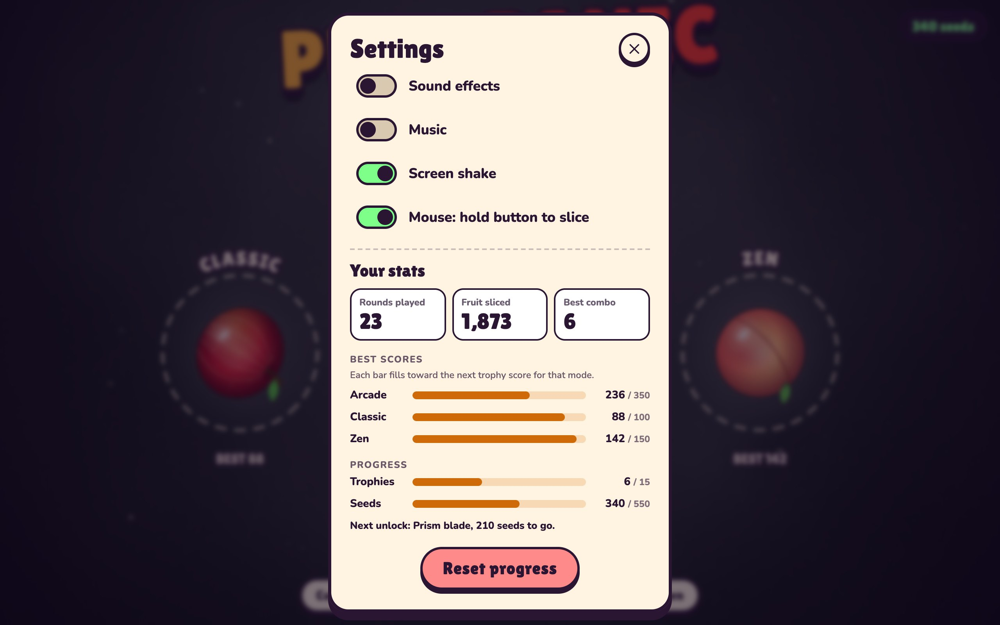
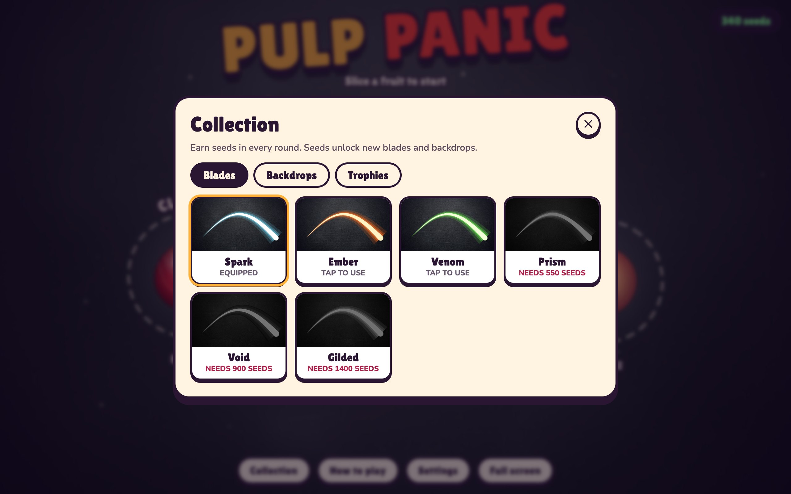
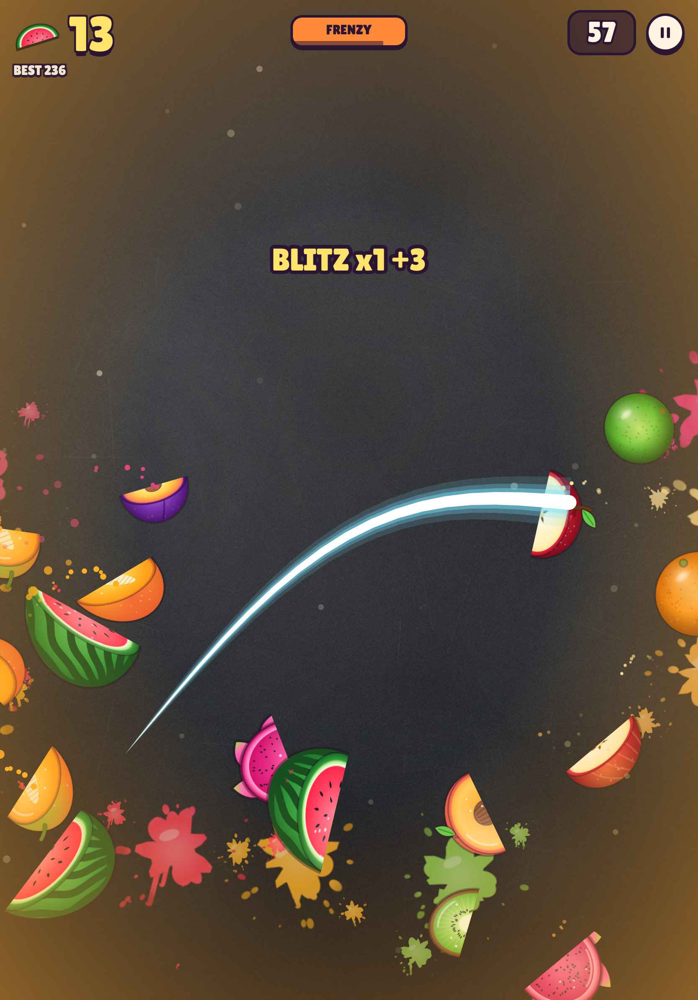

# Pulp Panic

A juicy arcade fruit-slicing game that runs in any modern browser and plays great on iPad. Swipe to slice, chain combos, dodge bombs, and smash the Grand Gourd at the end of every Arcade round.

**[Play it now: pulp-panic.fly.dev](https://pulp-panic.fly.dev)**

[](LICENSE)


[](https://claude.com/product/claude-code)



Everything you see and hear is generated in code: the fruit art, juice splats, backdrops, sound effects, and music. There are no image or audio assets, no frameworks, no build step, and zero dependencies. Plain HTML, CSS, and JavaScript modules on a Canvas 2D renderer with Web Audio.

## Built entirely by AI

Every line of this game was written by **[Claude Code](https://claude.com/product/claude-code)**, Anthropic's agentic coding tool, in a single session of about an hour and a half. It started from one prompt: build a full-featured fruit-slicing arcade game that is web native, plays on iPad, and shares live links early.

From there, Claude Code:

- designed and wrote the engine, the procedural fruit art, the synthesized sound effects and music, and all of the UI
- shared a live preview link within minutes, then improved the game in steps based on feedback
- tested full rounds automatically in Chromium and in WebKit (the iPad Safari engine) with simulated touch, and checked its own sound design with spectrograms, since it cannot listen
- deployed the game to Fly.io and set up this repository, the README, and the screenshots

The human part was direction and taste: what to build, how it should look and sound, the name, and the layout fixes.

## Screenshots

| Mode select | Grand Gourd finale |
|---|---|
|  |  |
| **Round results** | **Your stats** |
|  |  |
| **Collection** | **On iPad** |
|  |  |

## Modes

| Mode | Rules |
|---|---|
| **Arcade** | 60 seconds. A bomb costs 10 points but does not end the round. Catch power-ups. When time runs out, slash the Grand Gourd as many times as you can before it bursts. End-of-round bonuses for clean, skilled play. |
| **Classic** | No timer. Miss 3 fruit and the round ends. Cut a single bomb and it ends with a boom. Every 100 points gives back one miss. |
| **Zen** | 90 calm seconds with no bombs. Pure slicing. |

### Power-ups (Arcade)

| Fruit | Effect |
|---|---|
| **Frostberry** | Time slows down, including the clock, so you get extra time. |
| **Blazefig** | Frenzy: fruit flies in from both sides of the screen. |
| **Goldenberry** | Every point is doubled. |

### Scoring

- **1 point** per fruit
- **Combo**: cut 3 or more fruit in one swipe for a bonus equal to the fruit count
- **Bullseye**: cut through the exact center of a fruit for +2
- **Blitz**: keep slicing fast without a pause for growing bonuses
- **Arcade bonuses**: Bomb Dodger, Combo Crafter, Sharp Eye, Power Hungry, Fruit Fiend, Blitz Master

## Progress

- Every round earns **seeds**. Seeds unlock 6 blade styles and 5 backdrops in the Collection.
- **15 trophies**, each with a seed reward.
- Best scores, stats, and settings are saved in the browser (`localStorage`).
- Settings shows your stats as KPI tiles and progress meters: best score toward the next trophy for each mode, trophies earned, and seeds to the next unlock.

## Controls

- **Touch**: swipe across fruit. Each finger is its own blade.
- **Mouse**: hold the button and drag. A setting lets you slice without holding the button.
- **Keyboard**: `Esc` or `P` pauses.
- On the menu, slice a fruit to choose a mode, or just tap it.

## iPad and phones

- Multi-touch slicing, with page zoom and scroll gestures blocked during play.
- Add to Home Screen (Share, then Add to Home Screen) for full-screen play with an app icon.
- A service worker caches the game, so it also loads offline after the first visit.
- The layout adapts to portrait and landscape and keeps fruit in place when you rotate mid-round.

## Run locally

Requires Node.js 18 or newer. No install step.

```bash
node server.mjs
```

Then open http://localhost:5178. To share a temporary public link (needs [cloudflared](https://developers.cloudflare.com/cloudflare-one/connections/connect-networks/downloads/)):

```bash
./start.sh
```

## Deploy

The live site runs on [Fly.io](https://fly.io) as a small nginx container:

```bash
fly deploy --remote-only --ha=false
```

Files: `Dockerfile`, `deploy/nginx.conf`, `fly.toml`. The game is also served under `/pulp/`.

A Cloudflare Workers static-assets config is included for serving the game at a path on another domain: `./tools/build.sh && wrangler deploy` (edit the route in `wrangler.jsonc` first).

## Project structure

```
public/
  index.html            page shell and DOM screens
  css/style.css         UI styles
  js/main.js            boot, gesture blocking, service worker registration
  js/game.js            engine: input, physics, slicing, scoring, rendering
  js/art.js             procedural fruit, bomb, and power-up sprites
  js/modes.js           mode rules and the wave director
  js/audio.js           sound effect player and generative music
  js/baked.js           pre-rendered slice, bomb, swoosh, and fuse sounds
  js/ui.js              menu, HUD, results, collection, settings, stats
  js/themes.js          blades and backdrops
  js/trophies.js        trophy list
  js/store.js           saved progress
  sw.js                 offline cache (network first)
server.mjs              zero-dependency static server with no-cache headers
tools/make-icons.cjs    renders the app icons from the game art (needs Playwright)
docs/screenshots/       README images
```

## Debugging

- Add `?fps` to the URL to show the frame rate.
- `window.__pulp` is the game object in the browser console.

## License

[MIT](LICENSE)
